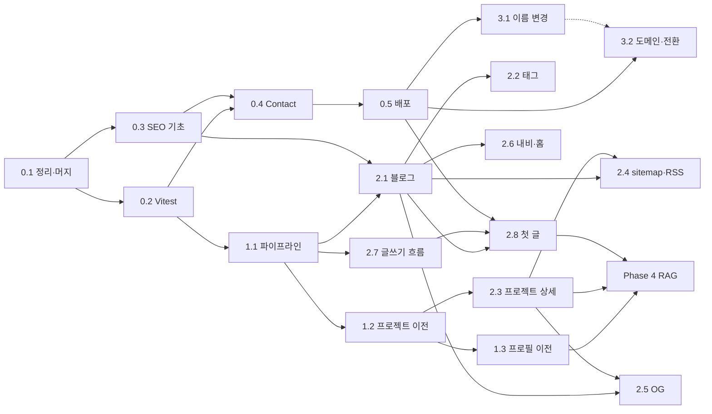

# 사이트 v2 계획 — 이력서 + 블로그 (+ 이후 RAG)

> 상태: **검토 반영 (2026-11-17)** · 초안은 메인 세션, 검토·수정은 리뷰 세션. 검토 내역은 맨 아래 [검토 결과](#검토-결과-리뷰-세션)에 있다.
> 기존 Lab 계획: [LAB_PLAN.md](./LAB_PLAN.md) · [TODO.md](./TODO.md) · 결정 기록: [DECISIONS.md](./DECISIONS.md) · 구조: [ARCHITECTURE.md](./ARCHITECTURE.md)
> 내용(사실)의 기준: **Notion「이력 원본 (Master)」(비공개)**. 숫자·용어는 `resume-fact-check` 스킬 규칙을 따른다.
> 이 저장소는 **공개**다. 이 문서·코드·PR 본문·글(draft 포함)에 연봉, 주소, Notion 비공개 페이지 ID·토큰, 회사 코드를 쓰지 않는다.

## 목표

1. resume-next를 **이력서이면서 계속 글을 올릴 수 있는 개인 사이트**로 만든다.
2. 예전 `resume`(Vite) 저장소를 흡수하고 정리한다. 저장소 이름은 바꿔도 된다.
3. 콘텐츠가 정리되면 **사이트 내용을 근거로 답하는 RAG 기능**을 별도 피처 브랜치로 붙인다.

## 범위 밖

- Next.js 16 업그레이드: 별도 작업으로 한다. 이 계획에서 고르는 라이브러리는 Next 16·Turbopack에서도 동작하는지만 확인한다.
- Lab 영어 카피: DECISIONS #5를 유지한다. Lab은 `[lang]` 밖의 `/lab/*`, 한국어 전용이다.
- 댓글, 사이트 검색, 뉴스레터, Notion → MDX 자동 변환.

## 현재 상태 (2026-11-17, 리뷰 세션이 저장소와 대조)

| 항목                 | 상태                                                                                                                                                                                                                                                                                                                      |
| -------------------- | ------------------------------------------------------------------------------------------------------------------------------------------------------------------------------------------------------------------------------------------------------------------------------------------------------------------------- |
| 프레임워크           | Next.js 15.5(설치 15.5.19), React 19.2, Tailwind 4, TypeScript 5.8, Yarn 1.22(classic). `/ko`·`/en`은 `generateStaticParams`로 SSG. `/lab` 허브와 데모 6종(ssr·ssg·isr·csr·charts·3d)은 `[lang]` 밖, 한국어 전용                                                                                                          |
| 브랜치               | `main`(로컬·origin)에는 첫 커밋 `3d21b92`만 있다. `feat/lab-content`에 커밋 3개(`a6b1d29`·`1763282`·`172599f`, 2026-07-10 push)와 미커밋 변경이 있다. 즉 `/ko`·`/en` 라우트와 colocation 구조도 아직 main에 없다                                                                                                          |
| 미커밋 변경          | Lab 콘텐츠·컴포넌트(`src/app/lab/**`), `/api/metrics`, 새 파일 `portfolio-metrics.ts`와 이를 쓰는 `StatsSection`, 이력 문구(`dictionaries.ts`·`projects.tsx`), 의존성(`recharts`·`three`·R3F), `.claude/skills`, docs. `tsconfig.tsbuildinfo`가 git에 추적되고 있어 빌드할 때마다 diff가 생긴다                           |
| 이력 데이터          | `projects.tsx`는 `buildPortfolioProjects(lang)` 함수 하나에 프로젝트 6개(yeoldal, pethroom-app, pethroom-admin, findirect, wnms, web-summary)를 ko/en 삼항식으로 담는다. `images`는 picsum 자리표시 URL이고 화면에서 쓰지 않는다. `color`는 Tailwind 클래스 문자열이다. 경력·학력은 `dictionaries.ts`의 `career` 블록이다 |
| 숫자 SSOT            | `src/lib/data/portfolio-metrics.ts` (StatsSection, Lab, `/api/metrics`가 같이 쓴다)                                                                                                                                                                                                                                       |
| 정적 자산            | `public/` 폴더가 없다. 루트의 `favicon.png`(약 750KB)와 `metadata.json`(AI Studio 템플릿 잔재)은 Next가 서빙하지 않는다. 그래서 지금 사이트에는 파비콘이 없다                                                                                                                                                             |
| SEO                  | `generateMetadata`에 canonical·hreflang이 있지만 `metadataBase`가 없어 빌드 HTML에 `href="/en"` 같은 상대 경로가 나간다. 루트 layout이 `<html lang="ko">`로 고정이라 `/en` 정적 HTML도 `lang="ko"`다(hydration 뒤 `HtmlLang`이 고친다). sitemap·robots·OG 이미지는 없다                                                   |
| 테스트               | resume-next와 예전 resume **둘 다 테스트 파일이 없다** → 옮길 테스트는 없다. README의 "Vitest 50 tests"는 Web Summary(다른 저장소) 이야기다                                                                                                                                                                               |
| CI                   | `.github/workflows/ci.yml`: Node 20, `yarn verify`(Prettier·ESLint·`tsc`·build). Node 20은 2026-04-30에 지원이 끝났다(로컬은 Node 22)                                                                                                                                                                                     |
| 환경 변수            | `NEXT_PUBLIC_WEB3FORMS_ACCESS_KEY` 하나. `prebuild`의 `scripts/check-env.mjs`가 이 키가 없으면 빌드를 멈춘다. Contact는 아직 클라이언트에서 직접 보낸다(TODO Week 4.1 미완)                                                                                                                                               |
| 의존성               | `zod`, MDX 관련 패키지 없음                                                                                                                                                                                                                                                                                               |
| 배포                 | resume-next는 **미배포**. 예전 Vite 사이트(`resume-iota-lyart-71.vercel.app`)가 사람인·잡코리아에 링크되어 있다                                                                                                                                                                                                           |
| 예전 `resume` 저장소 | GitHub 공개, archive 안 됨, 마지막 push 2026-07-04, homepage가 예전 Vercel URL. 테스트·`public/` 없음. resume-next README에도 "기술 스택 선택 이유" 절이 Next 기준으로 다시 쓰여 있다. 예전 저장소에만 남은 것은 Vite 시절 서술("React + Vite를 선택한 이유", "도메인 + shared 폴더 구조와 이유")이다 → 블로그 글 소재    |
| 문서 불일치          | `.cursor/rules/decision-protocol.mdc`의 "v1 OUT"에 `/ko` `/en` routes가 남아 있다(DECISIONS #13과 충돌). README가 Lab 작업 브랜치를 `feat/demo-hub-nextjs`로 적는다(실제는 `feat/lab-content`). `package.json`의 name이 `react-example`이다                                                                               |
| 공개 정보            | `src/lib/data/links.ts`의 이메일·휴대폰 번호가 Hero에 표시된다. 블로그로 검색 노출이 늘어나므로 계속 공개할지 확인이 필요하다(검토 결과 Q1)                                                                                                                                                                               |

## 작업 규칙 (Claude가 그대로 따라 실행)

- **작업 하나 = 브랜치 하나 = PR 하나.** 브랜치 이름은 `feat/site-<번호>-<요약>` (예: `feat/site-1.1-content-pipeline`).
- 작업 카드마다 **파일 · 내용 · 완료 기준 · 검증 · 선행 · 병렬**을 적는다. 순서와 병렬 여부는 맨 아래 [의존 관계](#의존-관계) 표가 기준이다.
- **병렬 가능**은 건드리는 파일이 겹치지 않는다는 뜻이다. 겹치면 카드에 적고, 나중에 머지되는 PR이 rebase한다.
- 모든 PR의 기본 조건: `yarn verify` 통과, CI 통과. 0.2 이후 `verify`에 테스트가, 1.1 이후 콘텐츠 생성이 포함된다.
- 구조가 바뀌면 같은 PR에서 `docs/ARCHITECTURE.md`를 고친다. 9점 이상 결정은 같은 PR에서 `docs/DECISIONS.md`에 한 줄 추가한다(아래 [제안 결정](#제안-결정-decisions-후보) 표에서 옮긴다).
- TODO.md의 해당 항목을 같은 PR에서 체크한다.
- 이력·글 문구를 바꾸는 PR은 `resume-fact-check` 표(주장·근거·상태·조치)를 PR 본문에 붙이고, ko/en을 함께 고친다.
- **사용자 승인 필요** 표시가 있는 작업(커밋 정리, main 머지, 배포, 저장소 이름 변경, 외부 링크 교체, archive)은 시작 전에 묻는다. 커밋·push는 사용자가 요청할 때만 한다(`context-anchor.mdc`).

## 제안 결정 (DECISIONS 후보)

`decision-protocol.mdc`의 9점 게이트를 적용했다. "반영 PR"이 머지될 때 `DECISIONS.md`에 옮긴다.

| #   | 결정                                                                                                                                                                                          | 점수 | 근거 · 반론 · 더 단순한 대안                                                                                                                                                                                                                                                                                                                                                  | 반영 PR |
| --- | --------------------------------------------------------------------------------------------------------------------------------------------------------------------------------------------- | ---- | ----------------------------------------------------------------------------------------------------------------------------------------------------------------------------------------------------------------------------------------------------------------------------------------------------------------------------------------------------------------------------- | ------- |
| D1  | 블로그 원본은 **저장소 안 MDX**. Notion은 비공개 원본용으로 유지                                                                                                                              | 9.5  | 버전 관리, 빌드에 외부 API 불필요, Preview로 검토 가능, RAG 코퍼스로 그대로 사용. 반론: 폰에서 쓰기 불편 → Notion 초안 → MDX 변환은 나중 과제                                                                                                                                                                                                                                 | 1.1     |
| D2  | 콘텐츠 파이프라인은 **content-collections(`parser: "frontmatter-only"`, Zod) + `@next/mdx`(dynamic import, RSC 렌더)**                                                                        | 9.0  | 아래 [콘텐츠 라이브러리 비교](#콘텐츠-라이브러리-비교-2026-11-17-확인). Zod 스키마로 타입 생성, production 빌드에서 잘못된 frontmatter가 빌드를 멈춘다. 본문은 `@next/mdx`가 Server Component로 컴파일해 클라이언트 JS가 없다. 둘 다 Turbopack·Next 16에서 동작. 반론: 도구가 둘이고 이미지 처리를 직접 해야 한다. 더 단순한 대안(`@next/mdx` 단독)은 frontmatter 검증이 없다 | 1.1     |
| D3  | 콘텐츠는 **저장소 루트 `content/`**, 배치는 `content/<종류>/<slug>/<lang>.mdx`, 이미지는 같은 폴더. `slug`·`lang`은 경로에서 만들고 frontmatter에 쓰지 않는다                                 | 9.0  | 원고는 코드가 아니라 `src/` 결정 트리(app·components·lib)에 맞지 않는다. 경로와 frontmatter가 어긋날 일이 없다. 반론: `src` 밖 import 경로. 대안 `src/content`는 원고와 코드가 섞인다                                                                                                                                                                                         | 1.1     |
| D4  | **en 대체 규칙**: `/en/blog/<slug>`는 en 파일이 있을 때만 만든다. `/en/blog` 목록에는 ko 전용 글을 "한국어" 배지와 `/ko/blog/<slug>` 링크로 보여 준다. hreflang은 두 언어가 다 있을 때만 단다 | 9.0  | 중복 콘텐츠와 잘못된 hreflang을 피하고 번역 부담이 없다. 반론: en 독자가 한국어 글로 이동한다(배지로 미리 알린다). 대안(en URL에 ko 본문 + canonical)은 복잡하다                                                                                                                                                                                                              | 2.1     |
| D5  | **`lang` 속성**: `[lang]/layout.tsx`가 콘텐츠를 `
`로 감싸 서버 HTML에 언어를 넣는다. `<html>`은 지금처럼 `HtmlLang`이 맞춘다                                                 | 9.0  | Google은 `lang` 속성을 언어 판단에 쓰지 않는다고 밝혔다([Google 문서](https://developers.google.com/search/docs/specialty/international/managing-multi-regional-sites)). 그래서 이득은 접근성(스크린 리더)이고, 한 줄 변경으로 충분하다. 기각한 대안: 다중 root layout(8.0) — `/ko`↔`/lab` 이동이 전체 새로고침이 되고 404 처리도 바뀐다                                      | 0.3     |
| D6  | **draft 규칙**: `draft: true`는 `next dev`와 `VERCEL_ENV === "preview"`에서만 페이지를 만들고 `noindex`·배너를 단다. Production 빌드, sitemap, RSS, RAG 인덱스에서는 항상 뺀다                | 9.0  | PR Preview에서 글을 검토할 수 있다. 반론: 저장소가 공개라 draft도 GitHub에서 보인다 → "draft ≠ 비공개"를 WRITING.md에 적는다                                                                                                                                                                                                                                                  | 1.1     |
| D7  | **태그는 정적 경로** `/[lang]/blog/tags/<tag>`. `searchParams`를 쓰지 않는다                                                                                                                  | 9.0  | 페이지에서 `searchParams`를 읽으면 라우트가 동적 렌더링으로 바뀌어 SSG가 깨진다. 대안(클라이언트 필터)은 JS가 필요하고 태그 URL이 색인되지 않는다                                                                                                                                                                                                                             | 2.2     |
| D8  | **테스트는 Vitest**, 대상은 데이터·로더·순수 함수와 빌드 산출물 검사. async Server Component는 단위 테스트하지 않는다                                                                         | 9.0  | Next 문서: Vitest는 async Server Component를 지원하지 않는다([Next 문서](https://nextjs.org/docs/app/guides/testing/vitest)). 이 사이트의 회귀 위험은 대부분 데이터 계층에 있다. 반론: 화면 회귀는 못 잡는다 → 빌드 HTML grep으로 보완                                                                                                                                        | 0.2     |
| D9  | RAG 벡터 저장은 **빌드 타임 JSON + 내적**으로 시작한다 (4.1 ADR에서 확정)                                                                                                                     | 9.0  | 코퍼스가 작다(MDX 수십 개). 외부 DB가 필요 없고 비용이 0이다. Supabase 무료 플랜은 일주일 활동이 없으면 일시 정지된다. Upstash Vector 내장 임베딩은 `text-embedding-3-small`뿐이라 한국어 품질을 따로 확인해야 한다                                                                                                                                                           | 4.1     |

---

## Phase 0 — 기반 정리

### 0.1 `feat/lab-content` 정리 → main 머지 — **사용자 승인 필요**

- **파일**: 지금의 미커밋 변경 전체, `.gitignore`, `README.md`, `.cursor/rules/decision-protocol.mdc`
- **내용**: 성격별 커밋으로 나눈 뒤 `feat/lab-content` → `main` PR을 연다. 이미 push된 커밋 3개도 함께 들어간다.
  1. `chore: tsconfig.tsbuildinfo 추적 해제` — `.gitignore`에 `tsconfig.tsbuildinfo`, `.claude/settings.local.json` 추가, `git rm --cached tsconfig.tsbuildinfo`
  2. `feat(lab): Lab 콘텐츠·컴포넌트, /api/metrics, portfolio-metrics SSOT` — `src/app/lab/**`, `src/app/api/metrics/**`, `src/lib/data/portfolio-metrics.ts`, `StatsSection.tsx`, `package.json`, `yarn.lock`
  3. `fix(resume): 이력 문구를 2026-11 PDF 기준으로 수정` — `dictionaries.ts`, `projects.tsx` (PR 본문에 fact-check 표)
  4. `chore: 이력서 스킬 추가` — `.claude/skills/**`(각 스킬의 LICENSE 유지), `.prettierignore`
  5. `docs: Lab 가이드·TODO·사이트 계획` — `docs/**`, `README.md`(브랜치 이름 정정), `decision-protocol.mdc`(v1 OUT에서 `/ko` `/en` 줄 삭제)
- **완료 기준**: main에서 `yarn verify` 통과, CI 통과, `git status --short`가 비어 있음, `tsconfig.tsbuildinfo`가 추적되지 않음
- **검증**: `yarn verify && git status --short && git ls-files tsconfig.tsbuildinfo` (마지막 두 명령은 출력이 없어야 한다)
- **선행**: 없음 · **병렬**: 불가 (모든 작업의 기반)

### 0.2 테스트 기반(Vitest) + CI 테스트 단계 + Node 버전

- **파일**: `package.json`(devDeps `vitest`, `vite-tsconfig-paths`; scripts `"test": "vitest run"`, `verify`에 `yarn test` 추가; `engines.node`), `vitest.config.mts`, `.nvmrc`, `.github/workflows/ci.yml`, 테스트 파일
  - `src/lib/i18n/dictionaries.test.ts`
  - `src/lib/data/projects/projects.test.ts`
  - `src/lib/data/projects/__fixtures__/projects.{ko,en}.json`
  - `src/lib/data/portfolio-metrics.test.ts`
  - `src/app/lab/_lib/routes.test.ts`
- **내용**:
  - 테스트 대상 (D8):
    - `dictionaries`: ko/en의 키 경로 집합이 같다 (타입이 이것을 강제하지 않는다)
    - 프로젝트: ko/en id 목록과 순서가 같고, achievements의 세 필드가 비어 있지 않다
    - golden fixture: 지금 `buildPortfolioProjects("ko" | "en")` 출력을 JSON으로 저장하고 일치를 검사한다 → 1.2 이전 작업의 회귀 기준
    - `portfolioMetrics`: before/after가 숫자이고 `unit` 형식이 맞다
    - `routes.ts`: 모든 href에 `src/app/lab/<seg>/page.tsx`가 있다 (`context-anchor.mdc`의 "MUST match" 규칙을 자동화)
  - CI: Node 20 → 22(로컬과 같음), `yarn test` 단계 추가. `.nvmrc`와 `engines`도 22로 맞춘다. Node 22 지원 종료는 2027-04-30이므로 그 전에 다시 올린다.
- **완료 기준**: `yarn test` 통과. CI 로그에 test 단계가 보인다. en 키 하나를 지우면 테스트가 실패하는 것을 로컬에서 확인한다(되돌리고 커밋).
- **검증**: `yarn test && yarn verify`
- **선행**: 0.1 · **병렬**: 0.3과 병렬 가능. 0.4와는 `package.json`·`ci.yml`이 겹친다.

### 0.3 SEO 기초 — `metadataBase`, `lang`, 파비콘

- **파일**: `src/lib/site.ts`(새 파일), `src/app/layout.tsx`, `src/app/[lang]/layout.tsx`, `src/app/icon.png`(루트 `favicon.png`를 512px 이하로 줄여 옮김), 루트 `favicon.png`·`metadata.json` 삭제(참조 없음 확인 후), `.env.example`, `docs/ARCHITECTURE.md`
- **내용**:
  - `siteUrl()`: `NEXT_PUBLIC_SITE_URL` → `https://${VERCEL_PROJECT_PRODUCTION_URL}` → `http://localhost:3000` 순서로 정한다. 루트 layout에 `metadataBase`로 넣는다.
  - D5: `[lang]/layout.tsx`가 children을 `
`로 감싼다.
  - Q1: 휴대폰 번호를 사이트에서 뺀다 — `src/lib/data/links.ts`의 `phone` 삭제, `src/app/[lang]/_components/HeroSection.tsx`의 표시 줄 삭제.
- **완료 기준**: `/en` 빌드 HTML의 canonical·hreflang이 절대 URL이다. `
`이 서버 HTML에 있다. `/icon.png`가 서빙된다. 빌드 HTML에 휴대폰 번호가 없다.
- **검증**: `yarn verify && grep -o '<link rel="canonical"[^>]*>' .next/server/app/en.html && grep -c '
/en | head -1`, `curl -sI <preview-url>/ko | grep -i x-robots-tag`
- **선행**: 0.4 · **병렬**: Phase 1·2와 병렬 가능

---

## Phase 1 — 콘텐츠 계층

### 콘텐츠 라이브러리 비교 (2026-11-17 확인)

| 후보                                  | 유지보수                                                                                    | Next 15.5 / React 19 / Turbopack                                                                           | RSC 렌더                                               | Zod 스키마·빌드 실패                                         | 이미지                                                       | 점수                         |
| ------------------------------------- | ------------------------------------------------------------------------------------------- | ---------------------------------------------------------------------------------------------------------- | ------------------------------------------------------ | ------------------------------------------------------------ | ------------------------------------------------------------ | ---------------------------- |
| **content-collections + `@next/mdx`** | core 0.15.3(2026-09), 저장소 활발. `@next/mdx`는 Next 공식                                  | `@content-collections/next` peer `next ^12–^16`. Turbopack에서는 remark/rehype 플러그인을 문자열로 지정    | `@next/mdx`가 Server Component로 컴파일 (클라 JS 없음) | Standard Schema(Zod). production에서 잘못된 문서는 빌드 실패 | 직접: MDX 안에서 `import`한 이미지를 `next/image`로          | **9.0 (채택)**               |
| Velite                                | 0.4.0(2026-06), 1.0은 alpha(Zod 4, Node ≥22.13)                                             | webpack 플러그인은 Turbopack에서 동작하지 않음. Next 16 + Turbopack 빌드 경합 이슈(#408) → CLI로 따로 실행 | `new Function`으로 실행하는 문자열. RSC 언급 없음      | Zod 기반 `s`. `strict: true`일 때만 실패(기본은 경고)        | 가장 좋다: `s.image()`가 크기·blur 제공, 상대 경로 자산 복사 | 8.0                          |
| `@next/mdx` 단독                      | Next 공식                                                                                   | 공식 지원                                                                                                  | 공식 지원                                              | **frontmatter 미지원**, 스키마 없음                          | 위와 같음                                                    | 7.5                          |
| next-mdx-remote                       | **2026년 초 archive**("no longer supported"). CVE-2026-0969(임의 코드 실행, 6.0.0에서 수정) | —                                                                                                          | `/rsc` 있었음                                          | 없음                                                         | —                                                            | 제외                         |
| (참고) next-mdx-remote-client         | 2.1.12(2026-08), next-mdx-remote 대체로 안내됨                                              | next 15·16 테스트됨, React ≥19.1                                                                           | `/rsc`                                                 | 없음 (content-collections와 조합 가능)                       | 직접                                                         | 8.5 (`@next/mdx` 대안)       |
| (참고) fumadocs-mdx                   | 15.6.3(2026-11)                                                                             | next ^15.3 / ^16                                                                                           | 지원                                                   | 있음                                                         | 상대 이미지를 자동으로 `next/image` import                   | 8.0 (Fumadocs 생태계에 묶임) |

출처: [content-collections Next 퀵스타트](https://github.com/sdorra/content-collections/blob/main/docs/quickstart/next.mdx), [dynamic import 샘플](https://github.com/sdorra/content-collections/tree/main/samples/next-mdx-dynamic-import), [Velite with Next.js](https://velite.js.org/guide/with-nextjs), [Velite #408](https://github.com/zce/velite/issues/408), [Next MDX 가이드](https://nextjs.org/docs/app/guides/mdx), [next-mdx-remote](https://github.com/hashicorp/next-mdx-remote), [GHSA-g4xw-jxrg-5f6m](https://github.com/advisories/GHSA-g4xw-jxrg-5f6m), [next-mdx-remote-client](https://github.com/ipikuka/next-mdx-remote-client).

선택 이유(D2): 요구 사항(Zod 스키마, 타입 생성, 잘못된 frontmatter → 빌드 실패, RSC 렌더, Next 16 대비)을 모두 만족하는 조합은 이것뿐이다. Velite는 이미지 처리가 가장 좋지만 Turbopack·Next 16 문제와 1.0 alpha 때문에 차점이다. 이미지가 많은 글이 늘어나 수동 import가 부담되면 그때 다시 평가한다.

### 1.1 콘텐츠 파이프라인 + 스키마 + 최소 상세 페이지

- **파일**:
  - `package.json`: devDeps `@content-collections/core`·`@content-collections/next`·`@content-collections/cli`, deps `@next/mdx`·`@mdx-js/loader`·`@mdx-js/react`·`@types/mdx`·`remark-frontmatter`·`remark-mdx-frontmatter`·`remark-gfm`·`rehype-slug`, `zod`(0.4가 먼저 머지되면 이미 있음). `@next/mdx`는 설치된 Next와 같은 15.5.x로 고정한다.
  - scripts: `"content": "content-collections build"`. `verify` 순서는 `format:check → lint → content → typecheck → test → build`로 바꾼다. 생성 폴더는 gitignore 대상이라 깨끗한 CI에서는 `tsc` 전에 먼저 만들어야 한다.
  - `content-collections.ts`, `next.config.ts`(`withContentCollections(withMDX(...))`, `withContentCollections`가 가장 바깥), `src/mdx-components.tsx`, `tsconfig.json`(paths `"content-collections": ["./.content-collections/generated"]`), `.gitignore`·`.prettierignore`(`.content-collections`)
  - `content/posts/hello-world/ko.mdx`(샘플, `draft: true`)
  - `src/lib/content/schema.ts`(Zod 스키마 export), `src/lib/content/posts.ts`(`getPosts(lang)`, `getPost(lang, slug)`, `isDraftVisible()`), `src/lib/content/*.test.ts`
  - `src/app/[lang]/blog/[slug]/page.tsx`(최소: 제목·날짜·본문만, `generateStaticParams`, `dynamicParams = false`)
  - `docs/ARCHITECTURE.md`(§2 트리에 `content/`, §5 SSOT 표), `docs/DECISIONS.md`(D1·D2·D3·D6)
- **스키마 (posts)**:
  - frontmatter: `title`, `date`(YYYY-MM-DD), `updated?`, `summary`, `tags: string[]`(소문자 kebab), `draft`(기본 false), `cover?`
  - 경로에서 만드는 값: `slug`(폴더 이름), `lang`(파일 이름 `ko`/`en`, 그 밖이면 에러)
  - transform에서 계산: `readingMinutes`, `headings`(h2·h3, 목차용)
- **구성 메모**:
  - `remark-frontmatter` + `remark-mdx-frontmatter`로 본문에서 frontmatter를 뺀다. 공식 샘플 `samples/next-mdx-dynamic-import`를 따른다.
  - Turbopack(Next 16 기본)을 대비해 remark/rehype 플러그인은 처음부터 문자열 이름으로 지정한다.
  - Prettier가 MDX 3 문법을 깨면 `.prettierignore`에 `content/**/*.mdx`를 추가한다. PR에서 실제로 확인한다.
- **완료 기준**:
  - `import { allPosts } from "content-collections"`가 타입과 함께 동작한다.
  - 샘플 글에서 `title`을 지우면 `NODE_ENV=production yarn build`가 실패한다. 실패 로그를 PR 본문에 붙인다. 실패하지 않으면 `content` 스크립트에서 강제로 실패시킨다.
  - 스키마 테스트(필수 필드 누락, 잘못된 lang, 잘못된 날짜)와 draft 필터 테스트가 통과한다.
  - `yarn dev`에서 `/ko/blog/hello-world`가 렌더된다. 이 페이지에 클라이언트 컴포넌트가 없다.
- **검증**: `yarn content && yarn test && yarn verify`
- **선행**: 0.2 · **병렬**: 0.3·0.4·0.5와 병렬 가능 (`package.json`은 0.4와 겹친다)

### 1.2 프로젝트 데이터 → `content/projects`

- **파일**:
  - `content/projects/<id>/{ko,en}.mdx` 12개
  - `content-collections.ts`(projects 컬렉션), `src/lib/content/projects.ts`(`getProjects(lang)`)
  - `src/lib/data/projects/projects.tsx` 삭제, `src/lib/data/projects/types.ts`(컬렉션 타입으로 대체하거나 alias), `src/app/[lang]/_components/ProjectsSection.tsx`, `ProjectCard.tsx`
  - 테스트 갱신
  - 경로를 적어 둔 문서: `docs/ARCHITECTURE.md`, `.claude/skills/resume-fact-check/SKILL.md` §5, `.cursor/rules/context-anchor.mdc`
- **스키마 (projects)**:
  - `title`, `category`, `subtitle`, `tags`, `order`(지금 순서 유지)
  - `color`: Tailwind 클래스 대신 `blue | orange | amber | purple | emerald | sky` 같은 토큰. 클래스는 `ProjectCard`에서 매핑한다. 클래스 문자열이 MDX로 가면 Tailwind 4 소스 스캔에서 빠질 수 있다.
  - `link?`: URL 또는 `profileLinks` 키(예: `chromeWebStore`). frontmatter에서는 TS 상수를 쓸 수 없으므로 키로 SSOT를 유지한다.
  - `achievements: {problem, thinking, result}[]`
  - `metrics?`: `portfolioMetrics` 키 배열(enum으로 검증)
  - 선택 필드 `role?`, `period?`, `company?`: 지금 데이터에 없다. 값은 fact-check를 거쳐 2.3 이후에 채운다.
  - `images`: picsum 자리표시이고 쓰이지 않으므로 옮기지 않는다(검토 결과 Q3).
  - 본문(MDX): 비워 둔다. 상세 서술은 2.3·2.8에서 쓴다.
- **완료 기준**: 새 로더 출력이 0.2의 golden fixture와 같다(`images`·`color` 표현 차이만 예외로 명시). `/ko`·`/en` 빌드 HTML의 프로젝트 섹션 텍스트가 이전과 같다. 문장은 한 글자도 바꾸지 않는다(문구 수정은 별도 PR).
- **검증**: `yarn test && yarn verify`. 이전 빌드 HTML과 텍스트를 비교한다: `.next/server/app/ko.html`을 이전 빌드에서 복사해 두고 태그를 지운 뒤 `diff`한다.
- **선행**: 1.1 · **병렬**: 2.1·2.7과 병렬 가능. 1.3과는 `content-collections.ts`가 겹쳐 순차.

### 1.3 경력·학력 → `content/profile` (RAG 전에만 필요)

- **파일**: `content/profile/{ko,en}.yaml`, `content-collections.ts`(profile 컬렉션, `parser: "yaml"`), `src/app/[lang]/_components/CareerSection.tsx`, `src/lib/i18n/dictionaries.ts`(`career` 블록에서 데이터를 빼고 제목 같은 UI 문구만 남김), 테스트
- **완료 기준**: Career 섹션의 빌드 HTML 텍스트가 이전과 같다. ko/en 항목 수와 순서가 같다는 테스트가 통과한다.
- **검증**: `yarn test && yarn verify`
- **선행**: 1.2 · **병렬**: Phase 2와 병렬 가능(`dictionaries.ts`는 2.1·2.6과 다른 블록을 고친다)

---

## Phase 2 — 블로그

### 2.1 블로그 목록 + 상세 완성

- **파일**: `src/app/[lang]/blog/page.tsx`, `src/app/[lang]/blog/[slug]/page.tsx`(1.1에서 확장), `src/app/[lang]/blog/_components/`(`PostList`, `PostMeta`, `Toc`, `PrevNext`, `DraftBanner`, `LangBadge`), `src/lib/content/posts.ts`(정렬, 이전·다음, 언어 대체 목록), `src/mdx-components.tsx`(`img`·`Image` 래퍼, 제목 앵커), `src/lib/i18n/dictionaries.ts`(`blog` 블록 ko/en), 테스트
- **내용**:
  - 목록: 날짜 내림차순, 읽는 시간, 태그(2.2 전에는 텍스트로만), 글이 없을 때 빈 상태 문구
  - 상세: 목차(h2·h3), 같은 언어 기준 이전·다음 글, `generateMetadata`(title, description, canonical, 두 언어가 다 있을 때만 hreflang — D4)
  - en 대체(D4), draft(D6): 위 결정대로 구현한다
  - 이미지:
    - 글 폴더에 두고 MDX에서 `import cover from "./cover.png"` 후 `<Image src={cover} alt="…" />`로 쓴다. 정적 import라 width/height가 자동으로 들어간다.
    - 마크다운 `` 상대 경로는 기본으로 해석되지 않으므로 쓰지 않는다(WRITING.md에 적는다).
    - `alt`는 래퍼에서 필수로 한다.
- **완료 기준**:
  - `yarn build` 출력에서 `/[lang]/blog/[slug]`가 SSG(●)다.
  - `VERCEL_ENV=production yarn build` 뒤 draft 글의 HTML이 없다.
  - `/en/blog/<ko 전용 글>`은 404이고, `/en/blog` 목록에는 그 글이 배지와 함께 보인다.
  - 정렬·이웃·대체 목록 테스트가 통과한다.
- **검증**: `yarn test && yarn verify && VERCEL_ENV=production yarn build && test ! -e .next/server/app/ko/blog/hello-world.html`
- **선행**: 1.1, 0.3 · **병렬**: 1.2·1.3·2.3·2.7과 병렬 가능

### 2.2 태그 페이지

- **파일**: `src/app/[lang]/blog/tags/[tag]/page.tsx`, `src/lib/content/posts.ts`(`getTags(lang)`), 목록의 태그 칩을 링크로 변경, 테스트
- **완료 기준**: 태그마다 정적 페이지가 생긴다(D7). 없는 태그는 404. 페이지에서 `searchParams`를 쓰지 않는다.
- **검증**: `yarn test && yarn verify`
- **선행**: 2.1 · **병렬**: 2.3~2.7과 병렬 가능

### 2.3 프로젝트 상세 `/[lang]/projects/[slug]` (TODO v1.5 승격, DECISIONS U3)

- **파일**: `src/app/[lang]/projects/[slug]/page.tsx`, `src/app/[lang]/projects/_components/*`, `src/app/[lang]/_components/ProjectCard.tsx`(상세 링크), `dictionaries.ts`(`projectDetail` 블록), `docs/TODO.md`, `docs/DECISIONS.md`(U3 갱신)
- **내용**: 경력기술서 형식(문제 → 내 역할 → 기술 선택 이유 → 성과)으로 보여 준다. 1.2의 achievements와 MDX 본문을 쓴다. 새 문장은 이 PR에서 쓰지 않는다(2.8처럼 글 PR에서 fact-check와 함께 쓴다).
- **완료 기준**: 6개 × 2개 언어 = 12개 페이지가 SSG로 생긴다. 홈 카드에서 상세로 이동한다. 없는 slug는 404.
- **검증**: `yarn test && yarn verify`
- **선행**: 1.2 · **병렬**: 2.1·2.2와 병렬 가능

### 2.4 sitemap · robots · RSS

- **파일**: `src/app/sitemap.ts`, `src/app/robots.ts`, `src/app/[lang]/feed.xml/route.ts`(`dynamic = "force-static"`, `generateStaticParams`), `src/lib/seo/sitemap-entries.ts`(순수 함수), 테스트, 블로그 목록의 `alternates.types`(RSS 링크)
- **내용**:
  - sitemap:
    - `/ko`·`/en`은 서로를 `alternates.languages`로 연결한다.
    - 블로그·프로젝트는 두 언어가 다 있을 때만 alternates를 단다(D4).
    - `/lab`·`/lab/*`는 ko만 넣는다.
    - draft는 넣지 않는다.
    - `lastModified`는 `updated ?? date`.
  - robots: `VERCEL_ENV === "production"`일 때만 허용하고 sitemap URL을 적는다. 그 밖에는 전부 막는다.
  - RSS: 언어별(`/ko/feed.xml`, `/en/feed.xml`). draft를 빼고 절대 URL을 쓴다(`siteUrl()`).
- **완료 기준**: sitemap 항목 테스트(draft 제외, ko 전용 글은 alternates 없음)가 통과한다. 빌드 뒤 `/sitemap.xml`과 `/ko/feed.xml`이 유효한 XML이다.
- **검증**: `yarn test && yarn build && yarn start` 후 `curl -s localhost:3000/sitemap.xml | head` 그리고 `curl -s localhost:3000/ko/feed.xml | head`
- **선행**: 2.1, 2.3 · **병렬**: 2.5·2.6과 병렬 가능

### 2.5 OG 이미지

- **파일**: `src/app/[lang]/opengraph-image.tsx`, `src/app/[lang]/blog/[slug]/opengraph-image.tsx`, `src/app/[lang]/projects/[slug]/opengraph-image.tsx`, `src/app/_assets/fonts/<한글 폰트>.ttf`(OFL 라이선스, 서브셋)
- **내용**: `next/og` 기본 폰트에는 한글이 없다. `ImageResponse`는 ttf·otf·woff만 받고(woff2 불가) 번들 한도가 500KB이므로 서브셋 ttf를 쓴다([Next 문서](https://nextjs.org/docs/app/api-reference/functions/image-response)).
- **완료 기준**: 빌드 때 정적으로 생성된다. 한글 제목이 두부 문자 없이 나온다(스크린샷을 PR에 첨부). 상세 HTML에 `og:image` 절대 URL이 있다.
- **검증**: `yarn verify && grep -o 'og:image" content="[^"]*' .next/server/app/ko/blog/*.html | head -3`
- **선행**: 2.1, 2.3 · **병렬**: 2.4·2.6과 병렬 가능

### 2.6 내비게이션 · 홈 연결

- **파일**: `src/app/[lang]/_components/HomePageClient.tsx`(nav), `src/app/lab/_components/LabNav.tsx`(사이트·블로그로 가는 링크), `src/app/[lang]/_components/LatestPostsSection.tsx`(새 파일, Server), `src/app/[lang]/page.tsx`, `dictionaries.ts`(`nav` 블록)
- **내용**: Nav는 Resume · Projects · Blog · Lab. 홈에 최근 글 3개를 보여 준다. DECISIONS #4(홈 = 이력서)를 지키기 위해 섹션은 Career 아래에 두고, 공개 글이 0개면 섹션을 숨긴다.
- **완료 기준**: 글이 0개일 때와 1개 이상일 때 모두 빌드된다. 홈 → 블로그 → 홈, `/lab` → 블로그 이동이 된다.
- **검증**: `yarn test && yarn verify`
- **선행**: 2.1 · **병렬**: 2.2~2.5와 병렬 가능

### 2.7 글쓰기 흐름

- **파일**: `scripts/new-post.mjs`, `package.json`(`"new:post": "node scripts/new-post.mjs"`), `docs/WRITING.md`
- **내용**:
  - `yarn new:post <slug> [--lang en]`: 스키마를 통과하는 `draft: true` 템플릿을 만든다. 같은 경로가 있으면 덮어쓰지 않고 실패한다.
  - `WRITING.md`에 적을 것:
    - frontmatter 표
    - 흐름: 새 글 → PR → Preview 확인 → 머지 → 자동 배포
    - 이미지 규칙: 같은 폴더, import 방식, `alt` 필수, 사진은 EXIF(위치) 제거, 1장 1MB 이하 권장
    - fact-check 절차
    - 공개 저장소 주의: draft도 공개, 비공개 정보·회사 코드 금지, 코드 예시는 새로 쓴 일반 예제
- **완료 기준**: 스크립트로 만든 글이 `yarn content`를 통과하고 `yarn dev`에서 보인다.
- **검증**: `yarn new:post tmp-check && yarn content && rm -r content/posts/tmp-check`
- **선행**: 1.1 · **병렬**: Phase 2 전체와 병렬 가능

### 2.8 첫 글 2~3개 — 글 1개 = PR 1개, **머지 전 사용자 확인**

- 후보:
  - 2.8a "Vite에서 Next.js로 옮긴 이유": 근거는 두 저장소의 README·커밋(공개), DECISIONS·ARCHITECTURE
  - 2.8b "Crashlytics를 Sentry와 병행 도입하고 비정상 종료율 3.89% → 0.02%": 숫자는 `portfolio-metrics.ts`, 서술 근거는 Notion 이력 원본의 근거 표
  - 2.8c "eCharts 렌더러를 Skia로 바꿔 40fps → 60fps": 위와 같음
- **규칙**: 회사 코드는 인용하지 않는다(회사 저장소는 비공개). 코드 예시는 새로 쓴 일반 예제임을 밝힌다. ko 먼저 쓰고, en은 글마다 고른다(U4).
- **파일**: `content/posts/<slug>/ko.mdx`(+ 이미지)
- **완료 기준**: PR 본문에 fact-check 표가 있다. `draft: false`. Preview URL에서 확인한다.
- **검증**: `yarn content && yarn verify`
- **선행**: 2.1, 2.7, 0.5(Preview) · **병렬**: 글끼리 병렬 가능

---

## Phase 3 — 저장소 통합 · 이름 변경

예전 `resume`와의 차이는 이번 검토에서 확인했다. 코드·자산은 옮길 것이 없고, Vite 시절 README 서술만 2.8a 소재로 쓴다. 그래서 초안의 "3.1 흡수(diff)"는 별도 작업으로 두지 않는다.

### 3.1 저장소 이름 변경 (선택) — **사용자 승인 필요**

- **파일**: `package.json`(`name`: `react-example` → 새 이름), `README.md`(제목·링크)
- **내용**:
  - GitHub에서 이름을 바꾼다. 이전 URL은 GitHub가 리다이렉트한다.
  - `git remote set-url origin <새 주소>`
  - Vercel 프로젝트의 Git 연결이 유지되는지 확인한다.
  - **로컬 폴더명은 바꾸지 않는다.** Claude Code 프로젝트 메모리와 `.claude/skills`가 폴더 경로에 묶여 있다.
- 외부 링크를 새 이름으로 한 번에 바꾸려면 3.2보다 먼저 한다. 이름을 유지하기로 하면(U2) 건너뛴다.
- **완료 기준**: `git remote -v`가 새 주소이고, Vercel에서 새 커밋이 배포된다.
- **검증**: `git ls-remote origin HEAD`
- **선행**: 0.5 · **병렬**: 다른 코드 작업과 병렬 가능

### 3.2 도메인 · 예전 사이트 전환 · archive — **사용자 승인 필요 (대부분 사용자 작업)**

- 순서가 중요하다. **archive하면 저장소가 읽기 전용이 되므로**, 예전 저장소 수정은 archive보다 먼저 해야 한다.
  1. 도메인을 정한다(U3). 커스텀 도메인 또는 `*.vercel.app`. Vercel에 연결하고 `NEXT_PUBLIC_SITE_URL`을 바꾼 뒤 재배포한다.
  2. 예전 `resume` 저장소에 `vercel.json` redirects(모든 경로 → 새 사이트 `/ko`)와 README 상단 이전 안내를 커밋한다. 예전 Vercel 배포가 리다이렉트를 서빙하는지 확인한다.
  3. 사람인·잡코리아·Notion의 포트폴리오 링크를 바꾼다(사용자 직접). 체크리스트는 Notion 이력 원본에서 관리하고, 이 문서에는 페이지 ID를 쓰지 않는다.
  4. GitHub에서 `resume`을 archive한다. 커밋 히스토리는 합치지 않는다.
- **완료 기준**: 예전 URL이 새 URL로 리다이렉트된다. 외부 링크 체크리스트가 완료된다. `resume`이 archive 상태다.
- **검증**: `curl -sI https://resume-iota-lyart-71.vercel.app/ | grep -i -E '^(HTTP|location)'`, `gh repo view khosyk/resume --json isArchived`
- **선행**: 0.5, 3.1(이름을 바꾸는 경우). 공개 글이 1개 이상 있는 상태(2.6, 2.8 중 하나 완료)를 권장한다.

---

## Phase 4 — RAG 질의응답 (설계 개요만, `feat/rag-qa`)

> 시작 조건: 1.2·1.3·2.1·2.3 완료, 공개 글 2개 이상.
> 기능이 배포되고 평가 수치가 나오기 전까지 이력서·포트폴리오·사이트 어디에도 "RAG"를 쓰지 않는다(`resume-fact-check` 규칙 2).
> 아래 카드는 개요다. 파일·수치는 4.1 ADR에서 확정한다. 하위 PR은 `feat/rag-qa`로 머지하고, 4.5가 끝나면 `feat/rag-qa` → `main` PR 하나로 올린다.

### 설계 메모 (2026-11-17 확인)

- **코퍼스**: `content/`의 공개 문서만 쓴다(draft 제외, Notion 제외). MDX에서 import·JSX를 빼고 heading 단위로 나눈다. 청크마다 `slug`·`lang`·앵커를 남겨 인용 링크를 만든다.
- **임베딩**: Anthropic은 자체 임베딩 모델이 없고 Voyage AI를 안내한다([Anthropic 문서](https://platform.claude.com/docs/en/build-with-claude/embeddings)). 한국어·영어를 섞어 쓰므로 다국어 모델(`voyage-4` 계열)을 후보로 둔다. 무료 토큰 범위 안에서 충분하다. 계정·키 발급은 사용자 작업이다.
- **벡터 저장(D9)**:

  | 옵션                  | 판단                                                                                                |
  | --------------------- | --------------------------------------------------------------------------------------------------- |
  | 빌드 타임 JSON + 내적 | 1순위. 코퍼스가 작고 비용이 0이다. Voyage 벡터는 정규화되어 있어 내적만으로 충분하다                |
  | Upstash Vector        | 무료 플랜은 충분하다. 다만 내장 임베딩이 `text-embedding-3-small`뿐이라 한국어 품질 확인이 필요하다 |
  | Supabase pgvector     | 무료 프로젝트는 일주일 동안 활동이 없으면 일시 정지된다 → 방문이 적은 포트폴리오에는 맞지 않는다    |

- **생성**: Anthropic Messages API의 `search_result` 콘텐츠 블록을 쓰면 답변에 출처 인용이 붙는다(정식 기능). 인용 기능은 structured output(`output_config.format`)과 함께 쓸 수 없다. 모델은 ADR에서 비용을 비교해 정한다(후보: `claude-haiku-5-5`는 비용 우선, `claude-sonnet-5-5`는 품질 우선). 연결 방식은 공식 `@anthropic-ai/sdk` 직접 호출과 Vercel AI SDK(`ai` v7 + `@ai-sdk/anthropic`, citations 지원) 중에서 고른다.
- **남용·비용 방어**:
  - Upstash Redis 무료 플랜 + `@upstash/ratelimit`으로 IP당 제한
  - Vercel BotID Basic(무료)
  - Anthropic 콘솔 월 사용 한도(사용자 작업)
  - 질문 길이 제한
  - Preview 환경에는 키를 넣지 않아 `/api/ask`를 끈다
- **범위·안전**: 코퍼스 밖 질문은 거절하고, 모든 답변에 인용을 붙인다. 도구 호출 없음. 질문 로그를 남긴다면 IP 없이 최소한으로 남긴다.

### 4.1 ADR — `docs/adr/0001-rag-qa.md`

- 위 메모를 근거와 함께 확정한다. 인덱스 생성 시점(매 빌드 vs 커밋된 산출물), 모델, 비용 상한, 평가 기준을 정한다. DECISIONS에 D9와 새 결정 행을 추가한다.
- **선행**: Phase 4 시작 조건

### 4.2 인덱서

- `scripts/rag-index.mjs`, `src/lib/rag/chunk.ts`(+ 테스트). 청킹은 순수 함수로 단위 테스트한다. 청크 해시가 바뀐 것만 다시 임베딩한다.
- **선행**: 4.1

### 4.3 `/api/ask`

- `src/app/api/ask/route.ts`: 검색 → `search_result` 블록 → 스트리밍 응답. rate limit을 적용하고, Production에서만 켠다.
- **선행**: 4.2

### 4.4 UI

- `/[lang]/ask` 페이지(Client island). 답변마다 출처 링크를 단다. 범위 밖 질문 안내 문구를 넣는다.
- **선행**: 4.3

### 4.5 평가

- `eval/golden.jsonl`(ko·en 섞어 20문항, 범위 밖 질문 포함), `scripts/rag-eval.mjs`
- 지표: 정답률, 인용 정확도(인용한 문서에 답이 실제로 있는지), 범위 밖 질문 거절률
- 비용과 secret이 필요하므로 CI에서는 `workflow_dispatch` 수동 실행으로만 둔다
- **선행**: 4.3

### 4.6 이력서 반영

- 배포와 4.5 수치가 나온 뒤에만 이력서·Notion·사이트에 기록한다. `resume-fact-check` 표를 붙인다.
- **선행**: 4.4, 4.5, `feat/rag-qa` → main 머지

---

## Vercel 환경 변수

| 변수                                                                                        | 범위                | 언제                              | 비고                                                                                                                     |
| ------------------------------------------------------------------------------------------- | ------------------- | --------------------------------- | ------------------------------------------------------------------------------------------------------------------------ |
| `WEB3FORMS_ACCESS_KEY`                                                                      | Production, Preview | 0.5                               | 서버 전용(0.4 이후). `check-env.mjs`가 없으면 빌드를 멈춘다. 예전 사이트에서 클라이언트에 노출된 키이므로 새로 발급 권장 |
| `NEXT_PUBLIC_SITE_URL`                                                                      | Production          | 0.5, 도메인을 정하면 3.2에서 갱신 | 없으면 `VERCEL_PROJECT_PRODUCTION_URL`, 그것도 없으면 localhost(0.3 `siteUrl()`)                                         |
| `VOYAGE_API_KEY`, `ANTHROPIC_API_KEY`, `UPSTASH_REDIS_REST_URL`, `UPSTASH_REDIS_REST_TOKEN` | Production만        | Phase 4                           | Preview에는 넣지 않는다 → `/api/ask` 비활성. 인덱싱을 빌드에서 하면 `VOYAGE_API_KEY`가 빌드 환경에도 필요하다            |
| Node.js 버전                                                                                | 프로젝트 설정       | 0.5                               | 22.x (`.nvmrc`·CI와 같게)                                                                                                |

`VERCEL_ENV`, `VERCEL_PROJECT_PRODUCTION_URL`은 Vercel이 자동으로 넣는다. 로컬·CI에서는 없다고 가정하고 코드를 쓴다.

## 리스크 · 빈틈

| 항목                  | 위험                                                                       | 대응                                                            | 작업      |
| --------------------- | -------------------------------------------------------------------------- | --------------------------------------------------------------- | --------- |
| i18n 대체             | en 글이 없을 때 중복 콘텐츠·잘못된 hreflang                                | D4                                                              | 2.1, 2.4  |
| `lang`·절대 URL       | `/en` HTML이 `lang="ko"`이고 canonical이 상대 경로                         | D5, `metadataBase`                                              | 0.3       |
| 글 이미지             | 크기 미지정으로 레이아웃이 흔들림, 원본 용량, 사진 EXIF의 위치 정보        | 정적 import + `next/image`, alt 필수, EXIF 제거 규칙            | 2.1, 2.7  |
| draft·Preview         | draft가 Production에 노출됨. 반대로 공개 저장소라 draft도 GitHub에서 보임  | D6, WRITING.md에 "draft ≠ 비공개"                               | 1.1, 2.7  |
| 언어별 sitemap        | Lab(ko 전용)·ko 전용 글에 엉뚱한 alternates                                | 두 언어가 다 있을 때만 alternates                               | 2.4       |
| 기존 테스트 이전      | 옮길 테스트가 없다(두 저장소 모두)                                         | 새로 만들고, 1.2 회귀 기준으로 golden fixture를 쓴다            | 0.2       |
| 생성 폴더와 검사 순서 | 깨끗한 CI에서 `.content-collections`가 없어 `tsc`·테스트 실패              | `verify`에서 `content`를 `typecheck` 앞에 둔다                  | 1.1       |
| Prettier와 MDX        | Prettier가 MDX 3 문법을 깨뜨릴 수 있다                                     | 확인 후 필요하면 `.prettierignore`                              | 1.1       |
| Turbopack·Next 16     | 업그레이드 때 MDX 플러그인 설정이 깨짐                                     | 플러그인은 문자열로 지정, 고른 라이브러리는 Next 16 호환 확인함 | 1.1       |
| Tailwind 클래스 이동  | MDX로 옮긴 클래스 문자열이 빌드 CSS에서 빠짐                               | `color`를 토큰 enum으로 바꾼다                                  | 1.2       |
| 문서의 경로 표기      | `projects.tsx`를 가리키는 스킬·규칙·ARCHITECTURE가 낡음                    | 1.2 PR에서 같이 고친다                                          | 1.2       |
| `searchParams`        | 태그 필터가 SSG를 깨뜨림                                                   | D7                                                              | 2.2       |
| OG 한글               | 기본 폰트에 한글이 없어 두부 문자                                          | 서브셋 ttf                                                      | 2.5       |
| Contact 남용·키 노출  | 스팸, 예전 사이트 번들의 키                                                | honeypot + Zod, 키 새로 발급                                    | 0.4, 0.5  |
| Node 20 EOL           | CI가 지원 종료 런타임으로 돈다                                             | Node 22로 통일                                                  | 0.2, 0.5  |
| 예전 사이트 전환 순서 | archive 뒤에는 예전 저장소에 리다이렉트를 커밋할 수 없다                   | 3.2 순서 고정                                                   | 3.2       |
| 공개 저장소           | 비공개 정보·회사 코드·Notion 비공개 ID 유입, `.claude/settings.local.json` | 작업 규칙, `.gitignore`, PR 체크                                | 0.1, 전체 |
| 개인 연락처           | 휴대폰 번호가 블로그와 함께 더 널리 색인됨                                 | 사용자 결정(Q1)                                                 | —         |
| RAG 비용·남용         | 공개 엔드포인트로 API 비용이 폭주                                          | rate limit, BotID, 월 한도, Preview 비활성                      | 4.3       |

## 사용자 결정 (2026-11-18: "추천대로 진행")

| #   | 질문                           | 결정                                                                                    | 반영할 작업 |
| --- | ------------------------------ | --------------------------------------------------------------------------------------- | ----------- |
| U1  | 블로그 원본 위치               | **저장소 안 MDX** (D1)                                                                  | 1.1         |
| U2  | 저장소 새 이름                 | **바꾸지 않는다.** 저장소 이름·로컬 폴더 그대로, 작업마다 브랜치를 딴다 → 3.1 삭제      | —           |
| U3  | 커스텀 도메인                  | 미정. 일단 `*.vercel.app`으로 배포하고 3.2 전에 다시 묻는다                             | 3.2         |
| U4  | 블로그 언어                    | **ko 우선, en은 글마다 선택** (D4)                                                      | 2.1         |
| U5  | 0.1 커밋 분리                  | **0.1의 5개 커밋**                                                                      | 0.1         |
| U6  | 예전 Vite 사이트               | **새 사이트로 리다이렉트한 뒤 저장소 archive**                                          | 3.2         |
| Q1  | 사이트의 휴대폰 번호           | **사이트에서 뺀다.** 이메일·Contact 폼만 남기고 번호는 이력서 PDF에만                   | 0.3         |
| Q2  | Web3Forms 키                   | **0.5에서 새로 발급** (사용자 작업)                                                     | 0.5         |
| Q3  | 프로젝트 `images`(picsum) 필드 | **버린다.** 실제 스크린샷은 2.1 이미지 규칙으로 다시 넣는다                             | 1.2         |
| Q4  | 1.3 경력·학력 YAML 이전        | **Phase 4 직전으로 미룬다**                                                             | 1.3         |
| Q5  | RAG 진행 방식                  | **통합 브랜치 `feat/rag-qa`**. 코퍼스 분리(JS 생태계 문서 / 이력 문의)는 아래 메모 참고 | Phase 4     |

> **Phase 4 범위 메모 (2026-11-18):** 사용자가 RAG를 두 갈래로 나누는 안을 냈다 — ① React·Node·JavaScript·Next.js 등 JS 생태계 문서 Q&A, ② 이력 관련 문의. 타당성 검토 결과는 메인 세션 보고에 있고, 확정되면 Phase 4 카드를 다시 쓴다.

## 의존 관계

| 작업     | 선행                        | 병렬 가능             | 파일 겹침 주의                     | 승인         |
| -------- | --------------------------- | --------------------- | ---------------------------------- | ------------ |
| 0.1      | —                           | —                     | —                                  | 필요         |
| 0.2      | 0.1                         | 0.3                   | `package.json`, `ci.yml` (0.4·1.1) |              |
| 0.3      | 0.1                         | 0.2                   | `.env.example` (0.4)               |              |
| 0.4      | 0.2, 0.3                    | 1.x                   | `package.json` (1.1)               |              |
| 0.5      | 0.4                         | 1.x, 2.x              | —                                  | 필요         |
| 1.1      | 0.2                         | 0.3, 0.4, 0.5         | `package.json` (0.4)               |              |
| 1.2      | 1.1                         | 2.1, 2.7              | `content-collections.ts` (1.3)     |              |
| 1.3      | 1.2                         | 2.x                   | `dictionaries.ts` (다른 블록)      |              |
| 2.1      | 1.1, 0.3                    | 1.2, 1.3, 2.3, 2.7    | `dictionaries.ts` (다른 블록)      |              |
| 2.2      | 2.1                         | 2.3~2.7               | `posts.ts` (2.1 이후라 순차)       |              |
| 2.3      | 1.2                         | 2.1, 2.2              | `ProjectCard.tsx`                  |              |
| 2.4      | 2.1, 2.3                    | 2.5, 2.6              | —                                  |              |
| 2.5      | 2.1, 2.3                    | 2.4, 2.6              | —                                  |              |
| 2.6      | 2.1                         | 2.2~2.5               | `dictionaries.ts` (`nav` 블록)     |              |
| 2.7      | 1.1                         | Phase 2 전체          | `package.json` (scripts 한 줄)     |              |
| 2.8a/b/c | 2.1, 2.7, 0.5               | 서로                  | —                                  | 머지 전 확인 |
| 3.1      | 0.5                         | 코드 작업             | `package.json`, `README.md`        | 필요 (선택)  |
| 3.2      | 0.5, (3.1)                  | —                     | 다른 저장소                        | 필요         |
| 4.1~4.6  | 1.2, 1.3, 2.1, 2.3 + 글 2개 | 4.4·4.5는 4.3 뒤 병렬 | —                                  | 4.6 확인     |

---

## 검토 결과 (리뷰 세션)

2026-11-17. 저장소(`package.json`, `src/`, `docs/`, `.cursor/rules`, `.github/workflows`, 빌드 산출물 `.next/server/app/*.html`, git 브랜치·이력)와 예전 `khosyk/resume` 저장소를 대조했다. 라이브러리는 공식 문서·GitHub·npm으로 확인했다. 구현은 하지 않았다.

### 바로잡은 사실

1. **"README의 기술 선택 이유는 아직 resume-next에 없음" → 틀림.** resume-next README에 "기술 스택 선택 이유" 절이 Next 기준으로 있다. 예전 저장소에만 남은 것은 Vite 시절 서술이다. 그래서 초안의 3.1(흡수 diff)은 별도 작업에서 뺐다.
2. **main 상태 추가.** main에는 첫 커밋만 있고, Next 라우트 구조 커밋 3개도 아직 `feat/lab-content`에만 있다.
3. **테스트**: 두 저장소 모두 테스트가 없어 "기존 테스트 이전"은 할 일이 없다. 대신 1.2 회귀 기준으로 golden fixture를 0.2에 넣었다.
4. **SEO 현황 추가**: `metadataBase`가 없어 canonical·hreflang이 상대 경로다. `/en` 정적 HTML이 `lang="ko"`다. 파비콘이 서빙되지 않는다(`public/` 없음). 모두 빌드 HTML에서 확인했다.
5. **기타 추가**: `tsconfig.tsbuildinfo` 추적, Node 20 EOL, `check-env`가 Vercel 빌드를 멈추는 조건, `decision-protocol.mdc`·README의 낡은 표기, `images`(picsum, 미사용), `color`(Tailwind 클래스) 필드.

### 라이브러리 결정 (1.1, Phase 4)

- **next-mdx-remote는 2026년 초 archive되었고**(GitHub에서 archived 상태 확인), 원격 코드 실행 CVE가 있었다 → 후보에서 뺐다.
- **`@next/mdx` 단독**은 frontmatter를 지원하지 않는다.
- **Velite**는 Turbopack·Next 16 문제가 열려 있고 1.0이 alpha다.
- 그래서 **content-collections + `@next/mdx`**를 D2(9.0)로 제안했다.
- 같이 넣은 구현 함정: 생성 폴더 때문에 `verify` 순서를 바꿔야 한다. 플러그인은 문자열로 지정한다. 상대 경로 마크다운 이미지는 해석되지 않는다.
- Phase 4:
  - Anthropic은 임베딩 모델이 없고 Voyage를 안내한다.
  - Supabase 무료 플랜은 일시 정지된다.
  - Upstash 내장 임베딩은 한국어 품질을 확인하지 않았다.
  - 그래서 빌드 타임 JSON을 1순위(D9)로 두었다. 인용은 `search_result` 블록으로 처리하도록 메모를 고쳤다.

### 구조 변경

- **카드 형식 통일**: 모든 작업에 파일·완료 기준·검증 명령·선행·병렬을 붙이고, 의존 표·그래프를 작업과 맞췄다. 초안 그래프의 `2.3 → 2.4 → 2.5 → 2.6` 직렬은 실제 의존이 아니어서 병렬로 풀었다.
- **쪼갬**:
  - 0.3 배포 → 0.3 SEO 기초 · 0.4 Contact · 0.5 배포
  - 1.2 이전 → 1.2 프로젝트 · 1.3 프로필
  - 2.1 → 2.1 블로그 · 2.2 태그
  - 2.3 SEO → 2.4 sitemap·RSS · 2.5 OG
  - 2.8 첫 글 → 글마다 PR
- **합침·삭제**: 3.1 흡수(내용 확인 완료). archive는 3.2의 마지막 단계로 넣었다.
- **새로 넣음**: 범위 밖, 제안 결정(D1~D9), Vercel 환경 변수 표, 리스크 표, draft 규칙, en 대체 규칙, 이미지 규칙, 3.2 순서(archive 전에 리다이렉트 커밋).
- **사용자 결정 표**: U1은 D1로 옮겨 추천을 유지했고, U5를 5개 커밋으로 바꿨고, U6을 추가했다.

### 확인하지 못한 것

- content-collections가 **CLI(`yarn content`) 경로에서도** 잘못된 frontmatter로 실패 코드를 내는지는 문서만으로 확정하지 못했다(Next 플러그인 경로의 production 실패는 확인). 1.1 완료 기준에 실제 확인을 넣었다.
- Prettier가 이 저장소의 MDX를 깨뜨리는지, MDX 안의 정적 이미지 import가 `content/`(src 밖)에서 동작하는지는 1.1·2.1 PR에서 확인한다.
- Vercel Preview의 `X-Robots-Tag: noindex` 기본값은 0.5에서 실제 응답으로 확인한다.
- Voyage 무료 등급의 분당 한도 수치는 찾지 못했다(4.1 ADR에서 확인).

### 사용자에게 묻는 것

- **Q1.** `links.ts`의 휴대폰 번호가 Hero에 공개되어 있다. 블로그를 붙이면 검색 노출이 늘어나는데, 계속 공개할까? (추천: 이메일·Contact 폼만 남기고 번호는 이력서 PDF에만)
- **Q2.** Web3Forms 키를 0.5에서 새로 발급할까? 예전 Vite 사이트 번들에 노출된 키다. (추천: 새로 발급)
- **Q3.** 프로젝트의 `images` 필드(picsum 자리표시, 화면 미사용)를 1.2에서 버려도 될까? 실제 스크린샷을 넣을 계획이면 대신 이미지 규칙(2.1)으로 다시 추가한다.
- **Q4.** 1.3(경력·학력 YAML 이전)은 RAG 코퍼스를 위해서만 필요하다. Phase 4를 확실히 할 때까지 미뤄도 될까?
- **Q5.** Phase 4를 통합 브랜치 `feat/rag-qa`로 할지(초안 의도), 기능 플래그를 두고 작은 PR을 main에 바로 넣을지? 이 문서는 초안대로 통합 브랜치로 적었다.
- 기존 U2(새 이름)·U3(도메인)·U6(예전 사이트 처리)도 Phase 3 전에 답이 필요하다.
